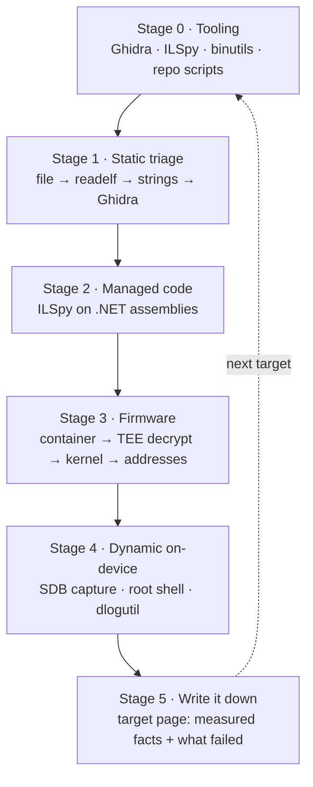

# Learning roadmap — reverse engineering for this project

This is a curated path, adapted to the artefacts in this repository. It borrows
heavily from the **REA** (Reverse Engineering Anything) material and the
`JoasASantos/REA-Prompts` collection; links are collected at the bottom. The
point is not to read everything — it is to be able to answer, for a TV you own:

> what does this binary do, what does this firmware contain, and why does this
> protection reject my file?

## Stage 0 — tooling you actually need here

| Tool | Why |
|---|---|
| **Ghidra** | ARM32 ELF disassembly/decompilation. The TV's launcher is an unstripped ARM ELF — a good first target. |
| **ILSpy** | .NET assemblies. Tizen TVs run managed code; the archive-root payloads and our own helpers are IL. |
| **objdump / readelf** | Fast triage before opening a GUI. What this repo used for the launcher. |
| **Our tools** | `foreshell.py`, `tvshell_server.py`, `uep-test.sh`, `capscan.sh`, `tee-client/`. |
| **REA (optional)** | Agentic RE workflows (feature tracing, version diffing, crash tracing). Useful later; not required for any step below. |

Deliberately **not** applicable to Tizen TVs: JADX/Frida/x64dbg (Android,
dynamic instrumentation, Windows). A Tizen TV is Linux/ARMv7 with its own
sandboxing — the on-device shell and `dlogutil` replace Frida here.

## Stage 1 — static basics on real artefacts

1. `file`, `readelf -h`, `readelf -s` on `dotnet-launcher-inhouse` (ARM, EABI5,
   not stripped). Note the symbols; they tell you more than the disassembly.
2. `strings` first. On this project it revealed the launcher's contract
   (`--standalone`, `coreclr_execute_assembly`, `Run it standalone`) in seconds.
3. Ghidra: import the ELF, let it find `main`, then follow the string xrefs.
4. Repeat on a small managed payload with ILSpy.

**Exercise:** find where the launcher decides to strip capabilities. (Answer:
it is not in the launcher — it is in the zone attach, via
`libsecurity-privilege-manager.so`; see [07](methodology/07-capabilities-and-zones.md).)

## Stage 2 — managed code

Tizen .NET payloads are ordinary assemblies. ILSpy on:

* `SamsungTvRootAgent.dll` — the archive-root agent protocol,
* our `tee.dll` — the TrustZone client,
* anything you build for a target.

**Exercise:** trace `getuid()` to the P/Invoke and explain why the reported uid
is `0` in the archive-root case but the SMACK label is still `User`.

## Stage 3 — firmware

Work through [02](methodology/02-firmware-container.md),
[03](methodology/03-tee-decrypt.md), [04](methodology/04-kernel-recovery.md).
This is the part most guides do not cover: an encrypted update container and a
TrustZone application that will decrypt it for a local app.

## Stage 4 — dynamic, on the device

There is no ptrace-based debugger on a retail TV. The equivalents are:

* the SDB injection + capture channel ([01](methodology/01-foothold.md)),
* a root shell over TCP ([10](methodology/10-debug-channels.md)),
* `dlogutil` for the device's own logs,
* `uep-test.sh` to classify execution policy empirically.

## Stage 5 — write it down

A target page ([targets/](targets/)) with the firmware string, the measured
facts, the addresses marked build-specific, and a "what did not work" section.
That last section is the most valuable one to the next person.

## External material

### Related reading (optional — not installed or endorsed here)

[REA repository](https://github.com/morluto/rea) ·
[website](https://rea.tools) ·
[installation notes](https://github.com/morluto/rea/blob/main/docs/installation.md) ·
[first investigation](https://rea.tools/first-investigation/) ·
[guides](https://rea.tools/guides/) ·
[guided MCP prompts](https://github.com/morluto/rea/blob/main/docs/mcp-prompts.md) ·
[REA-Prompts](https://github.com/JoasASantos/REA-Prompts)

> **Caution.** REA is an agent tool that runs shell commands and reads
> untrusted binaries. This repository does **not** install it, and nothing in
> the methodology above depends on it. If you choose to use it: pin an exact
> version instead of `@latest`, review the install script before running it,
> and keep the agent sandboxed away from credentials. Public accusations about
> the project's intent were checked and **not substantiated** (its npm package
> publishes no install hooks, and it has ~868k downloads/month), but
> prompt-injection-to-RCE is a real risk class for any tool of this kind —
> the caution is about the design pattern, not about that project.

### Watch and follow along
[Clone any software in minutes](https://youtube.com/watch?v=FnB9tHKBJXQ) ·
[REA + Pi coding agent tutorial](https://datacamp.com/tutorial/reverse-engineer-anything-rea-tutorial) ·
[Ghidra for beginners](https://youtube.com/watch?v=OFAxXXcLXbc) ·
[Frida for Android RE](https://youtube.com/watch?v=GHh9P-Dyq1w) ·
[pwn.college RE](https://pwn.college/intro-re-pwn~5933fc84/reversing/) ·
[Malware Unicorn RE101](https://malwareunicorn.org/workshops/re101)

### Investigated cases (read one before starting your own)
[Notes Export](https://rea.tools/first-investigation/) ·
[Notion Clipboard](https://rea.tools/showcase/notion/) ·
[DX-Ball reconstruction](https://rea.tools/showcase/dx-ball/) ·
[Aegis APK](https://rea.tools/showcase/aegis/) ·
[TH04 bullet patterns](https://rea.tools/showcase/th04/)

The DX-Ball case is the one worth studying for method: the reconstructed
function was checked on 3,205 inputs and the compiled result matched the original
63 bytes. That is a measurable check, not "the AI wrote plausible code".

### Tool repositories
[REA](https://github.com/morluto/rea) ·
[awesome-reverse-engineering](https://github.com/morluto/awesome-reverse-engineering) ·
[rea-gems](https://github.com/sqwu/rea-gems) ·
[awesome-reverse-engineered](https://github.com/alexgaoth/awesome-reverse-engineered) ·
[Ghidra](https://github.com/NationalSecurityAgency/ghidra) ·
[JADX](https://github.com/skylot/jadx) ·
[Frida](https://github.com/frida/frida) ·
[ILSpy](https://github.com/icsharpcode/ILSpy) ·
[x64dbg](https://github.com/x64dbg/x64dbg) ·
[Cutter](https://github.com/rizinorg/cutter) ·
[angr](https://github.com/angr/angr)

### Books
[The Ghidra Book, 2e](https://nostarch.com/ghidra-book-2e) ·
[Reverse Engineering for Beginners](https://go.yurichev.com) ·
[Practical Binary Analysis](https://nostarch.com/binaryanalysis/) ·
[Practical Malware Analysis](https://nostarch.com/malware) ·
[The Android Malware Handbook](https://nostarch.com/androidmalwarehandbook) ·
[Reversing: Secrets of Reverse Engineering](https://wiley.com/en-us/Reversing%3A+Secrets+of+Reverse+Engineering-p-9780764574818)

### Research papers
[LLM4Decompile](https://arxiv.org/abs/2403.05286) ·
[AutoDecompiler](https://arxiv.org/abs/2606.16162) ·
[SALT4Decompile](https://arxiv.org/abs/2509.14646) ·
[Decomperson](https://usenix.org/conference/usenixsecurity22/presentation/burk) ·
[DIRTY](https://usenix.org/system/files/sec22-chen-qibin.pdf) ·
[Automatically attacking software RE agents](https://arxiv.org/abs/2605.30667) ·
[Does RE need a bigger model?](https://rea.tools/blog/reverse-engineering-models/)

### Free courses and practice
[OST2 x86-64 Assembly](https://p.ost2.fyi/courses/course-v1%3AOpenSecurityTraining2%2BArch1001_x86-64_Asm%2B2021_v1/about) ·
[pwn.college RE](https://pwn.college/intro-re-pwn~5933fc84/reversing/) ·
[pwn.college Reversing Hell](https://pwn.college/reversing-hell/) ·
[Malware Unicorn RE101](https://malwareunicorn.org/workshops/re101) ·
[Nightmare](https://github.com/guyinatuxedo/nightmare) ·
[RPISEC MBE](https://github.com/RPISEC/MBE) ·
[OWASP MAS](https://mas.owasp.org) ·
[Crackmes.one](https://crackmes.one)

### The REA method in one line

> APP → ONE FEATURE → REA EVIDENCE → CLEAN SPEC → LOCAL REBUILD → TEST AGAINST ORIGINAL

No need to read everything in order. On this project the equivalent is:
**one binary → one decision (e.g. "where are my capabilities stripped?") →
evidence from the device → a written finding → a target page that the next
person can test.**

**Caveat on AI-assisted RE:** adversarial instructions can be embedded in the
binary under study and steer an agent. Treat model output as a hypothesis and
confirm it on the device or against known bytes — the same standard this repo
applies to every address it publishes.
